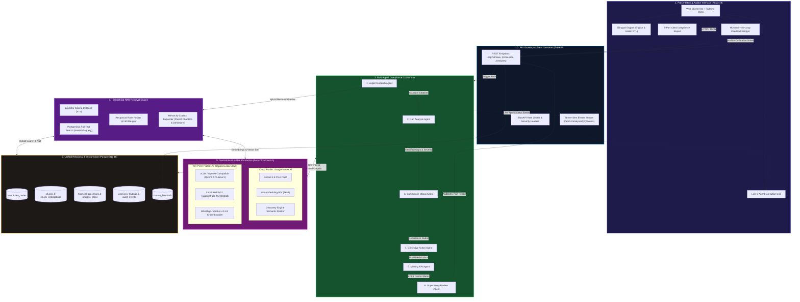

# ASCEND — AI-Assisted Compliance Platform for Financial Laws & Regulations

> Multi-agent hierarchical-RAG compliance intelligence platform cross-referencing government financial processes against Dubai public finance statutory laws, generating cited 5-part compliance audit reports with human-in-the-loop review.

---

## 🏛️ System Architecture Summary

The ASCEND platform operates as a multi-agent, hierarchical-RAG compliance system designed with dual cloud/on-premise portability. Below is the complete system architecture diagram with bounded component tiers and end-to-end data flow:

```
                      ┌────────────────────────────────────────────────────────┐
                      │            ASCEND Web Application (React 19)           │
                      │  • Bilingual UI (EN / Arabic RTL)   • Live Agent Grid  │
                      │  • 5-Part Cited Compliance Report   • Feedback Widget  │
                      └───────────────────────────┬────────────────────────────┘
                                                  │ HTTP REST / SSE Stream
                                                  ▼
                      ┌────────────────────────────────────────────────────────┐
                      │          FastAPI Compliance Gateway & API              │
                      │  • SlowAPI Rate Limiting            • SSE Event Stream │
                      │  • CORS & Middleware                • /health Check    │
                      └───────────────────────────┬────────────────────────────┘
                                                  │
                 ┌────────────────────────────────┴────────────────────────────────┐
                 │                                                                 │
                 ▼                                                                 ▼
┌────────────────────────────────────────────────┐  ┌────────────────────────────────────────────────┐
│         6-Agent Compliance Coordinator         │  │          Hierarchical Hybrid RAG Engine        │
│                                                │  │                                                │
│  ┌──────────────────────────────────────────┐  │  │  ┌──────────────────────────────────────────┐  │
│  │ 1. Legal Research Agent                  │  │  │  │ pgvector Cosine Distance (<=>)           │  │
│  └────────────────────┬─────────────────────┘  │  │  └────────────────────┬─────────────────────┘  │
│                       ▼                        │  │                       │                        │
│  ┌──────────────────────────────────────────┐  │  │  ┌────────────────────▼─────────────────────┐  │
│  │ 2. Gap Analysis Agent                    │  │  │  │ PostgreSQL Full-Text Search (BM25)       │  │
│  └────────────────────┬─────────────────────┘  │  │  └────────────────────┬─────────────────────┘  │
│                       ▼                        │  │                       │                        │
│  ┌──────────────────────────────────────────┐  │  │  ┌────────────────────▼─────────────────────┐  │
│  │ 3. Compliance Status Agent               │◄─┼──┼─►│ Reciprocal Rank Fusion (RRF k=60 Merge)  │  │
│  └────────────────────┬─────────────────────┘  │  │  └────────────────────┬─────────────────────┘  │
│                       ▼                        │  │                       │                        │
│  ┌──────────────────────────────────────────┐  │  │  ┌────────────────────▼─────────────────────┐  │
│  │ 4. Corrective Action Agent               │  │  │  │ Hierarchy & Breadcrumb Expander          │  │
│  └────────────────────┬─────────────────────┘  │  │  │ (Parent Chapters & Legal Definitions)    │  │
│                       ▼                        │  │  └──────────────────────────────────────────┘  │
│  ┌──────────────────────────────────────────┐  │  └───────────────────────┬────────────────────────┘
│  │ 5. Missing KPI Agent                     │  │                          │
│  └────────────────────┬─────────────────────┘  │                          │
│                       ▼                        │                          │
│  ┌──────────────────────────────────────────┐  │                          │
│  │ 6. Supervisory Review Agent              │  │                          │
│  │ (Grounding & Citation Verification)      │  │                          │
│  └────────────────────┬─────────────────────┘  │                          │
└───────────────────────┼────────────────────────┘                          │
                        │                                                   │
                        ▼                                                   ▼
┌────────────────────────────────────────────────────────────────────────────────────────────┐
│                         Pluggable Dual-Mode Provider Abstraction                           │
│                                                                                            │
│    [ Cloud Mode: Google Vertex AI ]             [ On-Premises Mode: Air-Gapped Local ]     │
│    • Gemini 1.5 Pro / Flash                     • vLLM / Ollama (Qwen2.5 / Llama 3)        │
│    • text-embedding-004 (768-dim)               • Local BGE-M3 / TEI (1024-dim)            │
│    • Discovery Engine Semantic Ranker           • BAAI/bge-reranker-v2-m3 Cross-Encoder    │
│                                                                                            │
│    * 100% configuration-driven via .env (Zero cloud leaks verified by AST tests)           │
└─────────────────────────────────────────────┬──────────────────────────────────────────────┘
                                              │
                                              ▼
┌────────────────────────────────────────────────────────────────────────────────────────────┐
│                           PostgreSQL 16 + pgvector Unified Store                           │
│                                                                                            │
│    • laws & law_nodes (Hierarchical AST)         • financial_processes & process_steps     │
│    • chunks & chunk_embeddings (Vector Store)    • analyses, findings & audit_events       │
│    • corrective_actions & kpi_metrics            • human_feedback & review audit logs      │
└────────────────────────────────────────────────────────────────────────────────────────────┘
```



### Architectural Highlights

| Layer | Technology | Primary Function | Portability Guarantee |
|---|---|---|---|
| **Presentation** | React 19, TypeScript, Tailwind CSS, `react-i18next` | Live agent monitoring, 5-part report visualization, and Arabic RTL support | Pure browser-based SPA; zero cloud lock-in |
| **API & Streaming** | FastAPI, Uvicorn, SlowAPI, Server-Sent Events (SSE) | Non-blocking execution, real-time agent event streaming, rate-limited REST | Standard Python ASGI runtime |
| **Workflow Engine** | State Graph Coordinator, Pydantic Schema Validation | Coordinates the 6 compliance agents with automated retries and schema grounding | In-process state graph; zero external queue needed |
| **Retrieval Engine** | pgvector + PostgreSQL FTS + RRF ($k=60$) | Hybrid lexical and semantic search with chapter and definition context expansion | Built directly into PostgreSQL; no third-party vector SaaS |
| **Model Inference** | Dual Provider Adapters (`app/providers/`) | Switches between Vertex AI and local vLLM / BGE models via `.env` configuration | Enforced by AST tests (`test_portability.py`) |
| **Persistent Storage** | PostgreSQL 16 (`NullPool` async engine) | Stores legal AST, processes, chunks, vectors, audit logs, and feedback | Works identically on local Docker, bare metal, or cloud RDS |

---

## Key Capabilities

1. **Multi-Agent Compliance Network:**
   - **Legal Research Agent:** Hybrid retrieval (pgvector cosine + FTS bm25 with RRF k=60) with statutory context expansion (parent chapters & legal definitions).
   - **Gap Analysis Agent:** Maps financial process steps against statutory obligations, categorizing omissions with strict severity ratings.
   - **Compliance Status Agent:** Article-by-article compliance status assignment (`COMPLIANT`, `NON_COMPLIANT`, `PARTIALLY_COMPLIANT`, `NOT_APPLICABLE`).
   - **Corrective Action Agent:** Actionable remediation plans with clear priority (`P1`, `P2`, `P3`), entity ownership, and timelines.
   - **Missing KPI Agent:** Supervisory control metrics, formula definitions, target thresholds, and audit review frequencies.
   - **Supervisory Review Agent:** Verifies citation grounding against actual statutory nodes and computes final rubric confidence.

2. **Zero-Cloud Switchable Architecture:**
   - Runs today on **Google Cloud Vertex AI** (Gemini 1.5, text-embedding-004, Discovery Engine ranking).
   - Switchable to **100% on-premises** (vLLM / Qwen2.5, BGE-M3, BGE-Reranker) via configuration only, zero code changes outside `providers/`.
   - Guaranteed by automated AST tests (`test_portability.py`).

3. **Bilingual Frontend Interface (English & Arabic RTL):**
   - Built with React 19, TypeScript, Vite, Tailwind CSS, and `react-i18next`.
   - Live SSE event streaming with 6-agent status grid, interactive event log, 5-part report accordion, and human-in-the-loop auditor feedback widget.

---

## Architecture & Project Structure

```
ascend/
├── backend/
│   ├── alembic/              # Database schema migrations
│   ├── app/
│   │   ├── agents/           # 6 specialized agents, schemas, validators, and prompt templates
│   │   ├── api/              # REST & SSE endpoints (laws, processes, analyses, feedback, dashboard)
│   │   ├── db/               # SQLAlchemy models (12 tables) & NullPool session engine
│   │   ├── ingestion/        # Parsers (PDF/DOCX/MD), hierarchy builder, chunker, indexer, eval runner, CLI
│   │   ├── providers/        # Vertex, OpenAI-compatible, Local & Fake providers + factory
│   │   ├── retrieval/        # Hybrid search (pgvector + FTS + RRF) & context expansion
│   │   ├── workflow/         # Multi-agent execution graph & event streamer
│   │   ├── main.py           # FastAPI application entrypoint
│   │   ├── settings.py       # Pydantic Settings & YAML loader
│   │   └── tests/            # 47 unit & integration tests
│   └── pyproject.toml        # Backend dependencies & tools
├── frontend/
│   ├── src/
│   │   ├── api/              # API client with EventSource SSE streaming
│   │   ├── components/       # Navbar, AgentGrid, EventLog, ReportAccordion, FeedbackWidget
│   │   ├── pages/            # Dashboard, Processes, Laws, Analyses, NewAnalysis, AnalysisDetail
│   │   ├── i18n/             # English and Arabic dictionaries with RTL dynamic direction
│   │   └── types/            # TypeScript interfaces
│   ├── package.json
│   └── vite.config.ts
├── data/
│   ├── fixtures/             # Synthetic Dubai public finance statutory law (3 chapters, 15 articles)
│   ├── processes/            # Standard government financial processes catalog (BGF-001, REV-001, etc.)
│   └── eval/                 # Gold evaluation benchmark cases
├── docs/
│   ├── DECISIONS.md          # Architectural decisions record
│   ├── ONPREM_MIGRATION.md   # Air-gapped on-premises deployment runbook
│   └── EVALUATION.md         # Automated benchmark evaluation results
├── docker-compose.yml
├── .env.example
└── config.yaml
```

---

## Quick Start Guide

### 1. Database Setup

Ensure PostgreSQL with pgvector is running:

```bash
docker compose up postgres -d
```

### 2. Backend Setup & Ingestion

```bash
cd backend

# Run database migrations
uv run alembic upgrade head

# Ingest statutory law fixture into PostgreSQL + pgvector
uv run python -m app.ingestion.cli ingest ../data/fixtures/synthetic_law.md --dry-run
uv run python -m app.ingestion.cli ingest ../data/fixtures/synthetic_law.md

# Start backend server
uv run uvicorn app.main:app --host 0.0.0.0 --port 8000 --reload
```

### 3. Frontend Setup

```bash
cd frontend

# Install dependencies (already initialized)
npm install

# Start Vite development server
npm run dev
```

Visit [http://localhost:5173](http://localhost:5173) in your browser.

---

## Testing & Quality Assurance

Run the comprehensive test suite (47 unit and integration tests):

```bash
cd backend
ENVIRONMENT=test uv run pytest app/tests/ -v
```

Run evaluation benchmark against gold dataset:

```bash
cd backend
ENVIRONMENT=test uv run python -m app.ingestion.cli eval
```

Build frontend production bundle:

```bash
cd frontend
npm run build
```

---

## Disclaimer

AI-assisted compliance output requires qualified legal and financial auditor review and does not constitute formal legal counsel.
