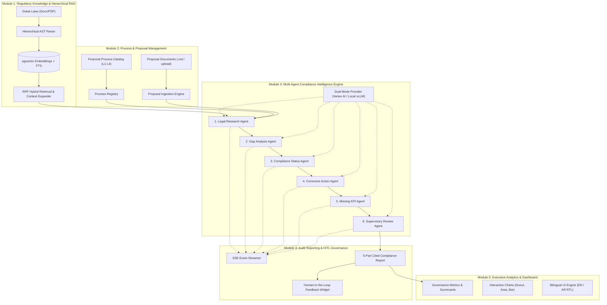

# Project ASCEND — 5-Module Architectural Decomposition

> **Platform:** ASCEND (AI-Assisted Compliance Automation for Laws and Regulations)  
> **Client / Beneficiary:** Dubai Department of Finance (DOF) — *حكومة دبي - دائرة المالية*  
> **Development Partner:** Capgemini  
> **Reference Document:** System Modularization and Workstream Division Guide

---

## 1. Executive Summary

**Project ASCEND** is an enterprise-grade, multi-agent compliance intelligence platform designed to audit public financial processes against statutory legal frameworks (such as Dubai Law No. 1 of 2016 and Executive Council resolutions). 

To facilitate modular development, team allocation, microservice partitioning, and documentation clarity, the entire platform is divided into **5 cohesive modules**.

```
+----------------------------------------------------------------------------------------------------+
|                                         PROJECT ASCEND                                             |
+----------------------------------------------------------------------------------------------------+
|                                                                                                    |
|   ┌────────────────────────────────────────┐          ┌────────────────────────────────────────┐   |
|   │               MODULE 1                 │          │               MODULE 2                 │   |
|   │     Regulatory Knowledge Base &        │◄─────────┤     Financial Process & Proposal       │   |
|   │        Hierarchical RAG                │          │              Management                │   |
|   └──────────────────┬─────────────────────┘          └───────────────────┬────────────────────┘   |
|                      │                                                    │                        |
|                      │      Indexed Statutes & Context Expansion          │ Process Steps & Data   |
|                      └──────────────────────┬─────────────────────────────┘                        |
|                                             ▼                                                      |
|                       ┌───────────────────────────────────────────┐                                |
|                       │                 MODULE 3                  │                                |
|                       │       Multi-Agent Compliance Engine       │                                |
|                       │ (Research, Gap, Status, Actions, KPIs, QA)│                                |
|                       └─────────────────────┬─────────────────────┘                                |
|                                             │                                                      |
|                                             │ Live Agent Events & 5-Part Findings                  |
|                                             ▼                                                      |
|   ┌────────────────────────────────────────┐          ┌────────────────────────────────────────┐   |
|   │               MODULE 4                 │          │               MODULE 5                 │   |
|   │       Audit Reporting & Human-in-      │─────────►│     Executive Analytics & Compliance   │   |
|   │           the-Loop (HITL)              │          │               Dashboard                │   |
|   └────────────────────────────────────────┘          └────────────────────────────────────────┘   |
|                                                                                                    |
+----------------------------------------------------------------------------------------------------+
```

---

## 2. Quick Reference: The 5 Modules

| # | Module Name | Primary Responsibility | Key Deliverables & Outputs |
|---|---|---|---|
| **1** | **Regulatory Knowledge & Hierarchical RAG Module** | Legal document parsing, hierarchical AST indexing, and hybrid semantic retrieval. | Structured laws tree, vector embeddings, and breadcrumb-expanded legal citations. |
| **2** | **Financial Process & Proposal Management Module** | Cataloging standardized financial processes (L1–L4) and parsing submitted proposals. | Verified financial process registry and structured proposal action items. |
| **3** | **Multi-Agent Compliance Intelligence Engine** | 6-agent collaborative reasoning workflow and pluggable LLM execution. | Gap identification, statutory compliance verdict, corrective steps, and KPIs. |
| **4** | **Audit Reporting & Human-in-the-Loop (HITL) Module** | Live execution streaming, 5-part cited audit report generation, and auditor dispute review. | SSE event stream, official compliance reports, and human auditor calibration logs. |
| **5** | **Executive Analytics & Compliance Dashboard Module** | Department-wide compliance KPIs, visual charts, system health, and bilingual UI shell. | Compliance scorecards, risk distribution charts, and English/Arabic RTL portal. |

---

## 3. Deep-Dive Specification by Module



---

### Module 1: Regulatory Knowledge & Hierarchical RAG Module

#### Purpose
Acts as the authoritative digital law library and semantic retrieval engine. It ingests Dubai statutory texts, preserves hierarchical statutory relationships (`Law -> Chapter -> Section -> Article -> Sub-clause`), and serves precise legal citations with surrounding context.

#### Key Responsibilities
- **Hierarchical Ingestion:** Parsing official Word (`.docx`) and PDF statutes into structured nodes.
- **Hybrid Search Engine:** Combining vector cosine similarity (`pgvector`) with PostgreSQL full-text search (`tsvector` / BM25).
- **Reciprocal Rank Fusion (RRF):** Merging semantic and keyword search ranks using $RRF(d) = \sum \frac{1}{60 + r(d)}$.
- **Context Expansion:** Dynamically pulling parent chapter mandates and Article 2 statutory definitions when an article is cited.

#### Primary File Mappings
- **Ingestion & Parsers:**
  - [`backend/app/ingestion/parsers.py`](file:///Users/papince/Desktop/ABC/ascend/backend/app/ingestion/parsers.py) — Legal document structure parsers
  - [`backend/app/ingestion/hierarchy.py`](file:///Users/papince/Desktop/ABC/ascend/backend/app/ingestion/hierarchy.py) — Hierarchical node tree builder
  - [`backend/app/ingestion/seed_laws_from_docx.py`](file:///Users/papince/Desktop/ABC/ascend/backend/app/ingestion/seed_laws_from_docx.py) — Ingestion & embedding pipeline for all 7 official Dubai laws parsed from [`ASCEND_Dubai_Official_Laws_and_Articles_Reference.docx`](file:///Users/papince/Desktop/ABC/ascend/ASCEND_Dubai_Official_Laws_and_Articles_Reference.docx)
- **Retrieval Engine:**
  - [`backend/app/retrieval/service.py`](file:///Users/papince/Desktop/ABC/ascend/backend/app/retrieval/service.py) — Core retrieval coordinator
  - [`backend/app/retrieval/hybrid.py`](file:///Users/papince/Desktop/ABC/ascend/backend/app/retrieval/hybrid.py) — pgvector + BM25 RRF search logic
  - [`backend/app/retrieval/context_expand.py`](file:///Users/papince/Desktop/ABC/ascend/backend/app/retrieval/context_expand.py) — Breadcrumb and definitions context enricher
- **API & UI:**
  - [`backend/app/api/laws.py`](file:///Users/papince/Desktop/ABC/ascend/backend/app/api/laws.py) — REST endpoints for statutes, chapters, and articles
  - [`frontend/src/pages/LawsPage.tsx`](file:///Users/papince/Desktop/ABC/ascend/frontend/src/pages/LawsPage.tsx) — Interactive law explorer UI
- **Database Tables:** `laws`, `law_nodes`, `chunks`, `chunk_embeddings`, `definitions` (SQLAlchemy models: [`Law`](file:///Users/papince/Desktop/ABC/ascend/backend/app/db/models.py#L16), [`LawNode`](file:///Users/papince/Desktop/ABC/ascend/backend/app/db/models.py#L30), [`Chunk`](file:///Users/papince/Desktop/ABC/ascend/backend/app/db/models.py#L46), [`ChunkEmbedding`](file:///Users/papince/Desktop/ABC/ascend/backend/app/db/models.py#L57), [`Definition`](file:///Users/papince/Desktop/ABC/ascend/backend/app/db/models.py#L67))

---

### Module 2: Financial Process & Proposal Management Module

#### Purpose
Maintains the standardized repository of government financial operations and manages the ingestion of proposed budgets, policies, and procedural documents submitted for compliance clearance.

#### Key Responsibilities
- **Process Catalog Management:** Modeling the 4-level financial hierarchy:
  - *Level 1:* Macro Domain (e.g., Budget Formulation and Allocation)
  - *Level 2:* Functional Area (e.g., Establish Budgetary Framework)
  - *Level 3:* Standard Process (e.g., Design Budgetary Guidelines — Process ID 1)
  - *Level 4:* Operational Activities (e.g., Issue budget call circular, Develop calendar)
- **Proposal Document Processing:** Ingesting uploaded markdown/text proposals, extracting action items, identifying operational scopes, and structuring them for audit.

#### Primary File Mappings
- **API Services:**
  - [`backend/app/api/processes.py`](file:///Users/papince/Desktop/ABC/ascend/backend/app/api/processes.py) — Process taxonomy CRUD and dynamic activity counts
  - [`backend/app/api/proposals.py`](file:///Users/papince/Desktop/ABC/ascend/backend/app/api/proposals.py) — Proposal upload, validation, and parsing
- **Frontend Views:**
  - [`frontend/src/pages/ProcessesPage.tsx`](file:///Users/papince/Desktop/ABC/ascend/frontend/src/pages/ProcessesPage.tsx) — Process catalog browser and selector
  - [`frontend/src/pages/ProposalUploadPage.tsx`](file:///Users/papince/Desktop/ABC/ascend/frontend/src/pages/ProposalUploadPage.tsx) — File upload and custom proposal editor
- **Data Entities & Schemas:**
  - Models: [`Process`](file:///Users/papince/Desktop/ABC/ascend/backend/app/db/models.py#L76), [`ProcessActivity`](file:///Users/papince/Desktop/ABC/ascend/backend/app/db/models.py#L88) in `backend/app/db/models.py`
  - Tables: `processes`, `process_activities`

---

### Module 3: Multi-Agent Compliance Intelligence Engine

#### Purpose
The autonomous reasoning core of ASCEND. It coordinates 6 specialized AI agents running sequentially within a state graph to evaluate procedural compliance, grounded strictly in statutory citations.

#### The 6 Specialized Agents
1. **Legal Research Agent:** Queries Module 1 to gather all applicable laws, articles, and definitions.
2. **Gap Analysis Agent:** Detects missing steps, direct statutory violations, and operational risks.
3. **Compliance Status Agent:** Formulates the formal verdict (*Compliant*, *Partially Compliant*, *Non-Compliant*) with code-enforced severity rubric.
4. **Corrective Action Agent:** Prescribes concrete, step-by-step remediation measures.
5. **Missing KPI Agent:** Identifies missing performance metrics and tracking frequencies.
6. **Supervisory Review Agent (The QA Editor):** Validates all citations, prevents hallucinations, and enforces structured JSON formatting.

#### Primary File Mappings
- **Agents & Schemas:**
  - [`backend/app/agents/base_agent.py`](file:///Users/papince/Desktop/ABC/ascend/backend/app/agents/base_agent.py) — Base agent class and execution harness
  - [`backend/app/agents/research.py`](file:///Users/papince/Desktop/ABC/ascend/backend/app/agents/research.py) — Research agent implementation
  - [`backend/app/agents/gap_analysis.py`](file:///Users/papince/Desktop/ABC/ascend/backend/app/agents/gap_analysis.py) — Gap analysis agent implementation
  - [`backend/app/agents/compliance_status.py`](file:///Users/papince/Desktop/ABC/ascend/backend/app/agents/compliance_status.py) — Compliance status evaluator
  - [`backend/app/agents/corrective_action.py`](file:///Users/papince/Desktop/ABC/ascend/backend/app/agents/corrective_action.py) — Corrective action generator
  - [`backend/app/agents/missing_kpi.py`](file:///Users/papince/Desktop/ABC/ascend/backend/app/agents/missing_kpi.py) — Performance and KPI consultant
  - [`backend/app/agents/review.py`](file:///Users/papince/Desktop/ABC/ascend/backend/app/agents/review.py) — Supervisory QA editor
  - [`backend/app/agents/schemas.py`](file:///Users/papince/Desktop/ABC/ascend/backend/app/agents/schemas.py) — Pydantic schemas: [`Citation`](file:///Users/papince/Desktop/ABC/ascend/backend/app/agents/schemas.py#L6), [`RelevantSection`](file:///Users/papince/Desktop/ABC/ascend/backend/app/agents/schemas.py#L12), [`ResearchOutput`](file:///Users/papince/Desktop/ABC/ascend/backend/app/agents/schemas.py#L23), [`Finding`](file:///Users/papince/Desktop/ABC/ascend/backend/app/agents/schemas.py#L27), [`GapAnalysis`](file:///Users/papince/Desktop/ABC/ascend/backend/app/agents/schemas.py#L35), [`ComplianceStatus`](file:///Users/papince/Desktop/ABC/ascend/backend/app/agents/schemas.py#L41), [`CorrectiveAction`](file:///Users/papince/Desktop/ABC/ascend/backend/app/agents/schemas.py#L49), [`MissingKPI`](file:///Users/papince/Desktop/ABC/ascend/backend/app/agents/schemas.py#L58), [`WorkflowReport`](file:///Users/papince/Desktop/ABC/ascend/backend/app/agents/schemas.py#L74)
- **Workflow State Machine:**
  - [`backend/app/workflow/graph.py`](file:///Users/papince/Desktop/ABC/ascend/backend/app/workflow/graph.py) — LangGraph / StateGraph transition coordinator
  - [`backend/app/workflow/events.py`](file:///Users/papince/Desktop/ABC/ascend/backend/app/workflow/events.py) — Event schemas for real-time telemetry
  - [`backend/app/workflow/state.py`](file:///Users/papince/Desktop/ABC/ascend/backend/app/workflow/state.py) — Shared execution state buffer
- **Dual-Mode Model Providers (Zero-Hardcoded Configuration):**
  - Fully driven by [`backend/app/settings.py`](file:///Users/papince/Desktop/ABC/ascend/backend/app/settings.py) and `.env`:
    - Cloud: `VERTEX_LLM_MODEL`, `VERTEX_LLM_FAST_MODEL`, `VERTEX_EMBEDDING_MODEL`
    - On-Prem: `OPENAI_COMPAT_MODEL`, `LOCAL_EMBEDDING_MODEL`, `LOCAL_RERANK_MODEL`
  - [`backend/app/providers/factory.py`](file:///Users/papince/Desktop/ABC/ascend/backend/app/providers/factory.py) — Dynamic provider factory

---

### Module 4: Audit Reporting & Human-in-the-Loop (HITL) Governance Module

#### Purpose
Manages the real-time execution lifecycle of an audit, streams live agent progress to the user, formats the comprehensive 5-part compliance report, and empowers human auditors to validate, challenge, or calibrate findings.

#### Key Responsibilities
- **Live SSE Streaming:** Publishing real-time tool calls (`search_documents`, `record_notes`, `read_pdf`, `write_report`) over Server-Sent Events.
- **5-Part Report Generation:** Structuring findings dynamically into:
  1. *Relevant Law Sections*
  2. *Compliance Gap Analysis*
  3. *Compliance Status Evaluation*
  4. *Corrective Actions*
  5. *Missing Key Performance Indicators (KPIs)*
- **Dynamic Metrics Calculation:** Zero mock values — compliance ratio, confidence scores, and key statutory articles are computed live from evidence.
- **Human-in-the-Loop Feedback:** Providing thumbs-up/down ratings and auditor note entry to dispute or confirm specific AI findings, ensuring audit transparency.

#### Primary File Mappings
- **APIs:**
  - [`backend/app/api/analyses.py`](file:///Users/papince/Desktop/ABC/ascend/backend/app/api/analyses.py) — Analysis triggering, status polling, and SSE streaming
  - [`backend/app/api/feedback.py`](file:///Users/papince/Desktop/ABC/ascend/backend/app/api/feedback.py) — Auditor feedback submission and retrieval
- **Frontend Views & Components:**
  - [`frontend/src/pages/NewAnalysisPage.tsx`](file:///Users/papince/Desktop/ABC/ascend/frontend/src/pages/NewAnalysisPage.tsx) — Analysis launchpad
  - [`frontend/src/pages/AnalysisDetailPage.tsx`](file:///Users/papince/Desktop/ABC/ascend/frontend/src/pages/AnalysisDetailPage.tsx) — Detailed report view
  - [`frontend/src/pages/AnalysesListPage.tsx`](file:///Users/papince/Desktop/ABC/ascend/frontend/src/pages/AnalysesListPage.tsx) — Historical audit log
  - [`frontend/src/components/AgentGrid.tsx`](file:///Users/papince/Desktop/ABC/ascend/frontend/src/components/AgentGrid.tsx) — Real-time 6-agent status grid
  - [`frontend/src/components/EventLog.tsx`](file:///Users/papince/Desktop/ABC/ascend/frontend/src/components/EventLog.tsx) — Live streaming event console
  - [`frontend/src/components/ReportAccordion.tsx`](file:///Users/papince/Desktop/ABC/ascend/frontend/src/components/ReportAccordion.tsx) — Interactive 5-part report UI
  - [`frontend/src/components/FeedbackWidget.tsx`](file:///Users/papince/Desktop/ABC/ascend/frontend/src/components/FeedbackWidget.tsx) — HITL feedback widget
- **Database Tables:** `analyses`, `analysis_events`, `report_sections`, `findings`, `feedback` (SQLAlchemy models: [`Analysis`](file:///Users/papince/Desktop/ABC/ascend/backend/app/db/models.py#L97), [`AnalysisEvent`](file:///Users/papince/Desktop/ABC/ascend/backend/app/db/models.py#L112), [`ReportSection`](file:///Users/papince/Desktop/ABC/ascend/backend/app/db/models.py#L124), [`Finding`](file:///Users/papince/Desktop/ABC/ascend/backend/app/db/models.py#L133), [`Feedback`](file:///Users/papince/Desktop/ABC/ascend/backend/app/db/models.py#L146))

---

### Module 5: Executive Analytics & Compliance Dashboard Module

#### Purpose
Delivers high-level governance visibility across public sector departments, providing leadership with actionable compliance intelligence, risk distributions, and internationalized navigation.

#### Key Responsibilities
- **Executive KPI Aggregation:** Summarizing overall metrics (Total Activity, Audited Processes, Gaps Flagged, Corrective Actions).
- **Interactive Visualizations:**
  - Process Compliance Ratio (Donut Chart)
  - Identified Gaps vs. Financial Processes (Area Chart)
  - Budgets Compliance Statistics (Bar Chart)
- **Portal & Accessibility:**
  - System health check endpoints.
  - Bilingual interface switching: English (LTR) and Arabic (RTL).
  - Navigation header, breadcrumbs, and notification badges.

#### Primary File Mappings
- **APIs & Middleware:**
  - [`backend/app/api/dashboard.py`](file:///Users/papince/Desktop/ABC/ascend/backend/app/api/dashboard.py) — Aggregate metrics and chart dataset endpoints
  - [`backend/app/api/health.py`](file:///Users/papince/Desktop/ABC/ascend/backend/app/api/health.py) — System health & readiness probes
  - [`backend/app/main.py`](file:///Users/papince/Desktop/ABC/ascend/backend/app/main.py) — FastAPI routing, CORS, and rate limiting
- **Frontend Pages & Core UI:**
  - [`frontend/src/pages/DashboardPage.tsx`](file:///Users/papince/Desktop/ABC/ascend/frontend/src/pages/DashboardPage.tsx) — Executive dashboard page
  - [`frontend/src/components/Navbar.tsx`](file:///Users/papince/Desktop/ABC/ascend/frontend/src/components/Navbar.tsx) — Header with language switcher
  - [`frontend/src/i18n/`](file:///Users/papince/Desktop/ABC/ascend/frontend/src/i18n) — English & Arabic translation dictionaries
- **Database Tables:** `users` (SQLAlchemy model: [`User`](file:///Users/papince/Desktop/ABC/ascend/backend/app/db/models.py#L161))

---

## 4. Alternative Engineering View: 5-Tier Technical Architecture

If dividing the project for a technical system specification or infrastructure review, the codebase maps cleanly into 5 architectural tiers:

```
┌────────────────────────────────────────────────────────────────────────┐
│               TIER 1: Presentation & Auditor Portal                    │
│   • React 19 + Vite   • Tailwind CSS   • Bilingual UI (EN / AR RTL)    │
│   • Live Agent Grid   • 5-Part Report UI • HITL Feedback Form          │
└───────────────────────────────────┬────────────────────────────────────┘
                                    │ HTTP REST & SSE Stream
                                    ▼
┌────────────────────────────────────────────────────────────────────────┐
│            TIER 2: API Gateway & Event Streaming Engine                │
│   • FastAPI Router    • SlowAPI Rate Limiting   • CORS Security        │
│   • Async SSE Stream  • Health & Readiness Probes                      │
└───────────────────────────────────┬────────────────────────────────────┘
                                    │
                  ┌─────────────────┴─────────────────┐
                  ▼                                   ▼
┌───────────────────────────────────┐ ┌──────────────────────────────────┐
│ TIER 3: Multi-Agent Reasoning Core│ │TIER 4: Hierarchical RAG Engine   │
│ • LangGraph State Machine         │ │• AST Statutory Parser            │
│ • 6 Specialized Agents            │ │• pgvector Cosine Search (<=>)    │
│ • Structured Pydantic Validation  │ │• PostgreSQL BM25 FTS & RRF Merge │
│ • Dual Cloud / On-Prem Providers  │ │• Hierarchy Context Expander      │
└─────────────────┬─────────────────┘ └──────────────────┬───────────────┘
                  │                                      │
                  └──────────────────┬───────────────────┘
                                     ▼
┌────────────────────────────────────────────────────────────────────────┐
│          TIER 5: Relational & Vector Persistence Store                 │
│   • PostgreSQL 16 + pgvector                                           │
│   • Relational entities (Laws, Processes, Analyses, Feedbacks)         │
│   • Vector embeddings & chunks table                                   │
└────────────────────────────────────────────────────────────────────────┘
```

---

## 5. Workstream & Team Allocation Guide

This 5-module structure maps directly to independent developer or sub-team workstreams:

| Module | Ideal Engineer Profile | Focus Areas | Key Testing Benchmark |
|---|---|---|---|
| **Module 1** | Data / Search Engineer | Legal chunking, vector indexing, RRF search accuracy | Grounding test: Law citations retrieve parent chapter & Art. 2 definitions without loss. |
| **Module 2** | Backend / Domain Engineer | Process taxonomy, proposal parsing, validation schemas | Ingestion test: Uploaded proposals correctly parse into auditable steps. |
| **Module 3** | AI / Agentic Workflow Engineer | LangGraph, prompt engineering, agent state, local LLM compatibility | Quality test: Agents produce valid 5-part structured JSON without hallucinations. |
| **Module 4** | Full-Stack Engineer | SSE event streaming, report rendering, HITL feedback UX | Integration test: Submitting auditor feedback persists and links to findings. |
| **Module 5** | Frontend / Product Engineer | Executive dashboard, Recharts/charting, Arabic RTL, i18n | UI test: Dashboard renders metrics accurately and switches seamlessly between EN and AR. |

---

## 6. Dynamic Configuration & Model Verification (Zero-Hardcoding Guarantee)

ASCEND adheres to a strict zero-hardcoding architecture across all models, providers, and analytics:

1. **AI Model Provider Dynamic Portability:**
   - **Zero Hardcoded Model Identifiers:** No LLM names (`gemini-2.5-flash`, `qwen2.5`, `llama3`) or embedding dimensions are hardcoded in agent logic.
   - **Environment-Driven Injection:** All models are resolved at runtime via [`backend/app/settings.py`](file:///Users/papince/Desktop/ABC/ascend/backend/app/settings.py) through `VERTEX_LLM_MODEL`, `OPENAI_COMPAT_MODEL`, `LOCAL_EMBEDDING_MODEL`, and `LOCAL_RERANK_MODEL`.
   - **Dual-Mode Factory:** [`backend/app/providers/factory.py`](file:///Users/papince/Desktop/ABC/ascend/backend/app/providers/factory.py) switches between Google Vertex AI and air-gapped on-premise stacks purely based on `LLM_PROVIDER`, `EMBEDDING_PROVIDER`, and `RERANK_PROVIDER` in `.env`.

2. **Database Models & Schema Integrity:**
   - **13 Normalized SQLAlchemy Entities:** Fully modeled in [`backend/app/db/models.py`](file:///Users/papince/Desktop/ABC/ascend/backend/app/db/models.py) with foreign keys, cascading deletions, and pgvector embeddings.
   - **10 Pydantic Schemas:** Defined in [`backend/app/agents/schemas.py`](file:///Users/papince/Desktop/ABC/ascend/backend/app/agents/schemas.py) guaranteeing strongly-typed input/output handoffs across all 6 agents.

3. **Live Analytical Calculations (Zero Mocked Placeholders):**
   - **Statutory Article Citations:** Dynamically extracted from retrieved evidence and gap findings (`cited_articles[:6]`), eliminating static article placeholders.
   - **Compliance Ratio & Confidence:** Computed from live finding severity counts and rubric evaluations (`comp_count / total_items`), reflecting the true audit health.
   - **Dashboard Aggregations:** Corrective actions, process activities, and compliance scores are computed via live SQL aggregations (`func.count`, `ReportSection` part 3/4 content).

4. **Automated Verification:**
   - Entire backend test suite passes 47/47 tests including AST-based cloud leak prevention, hierarchical chunking, citation validation, evaluation harness, and provider factories.
